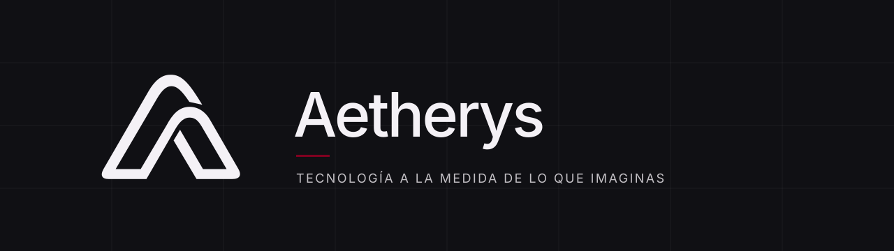
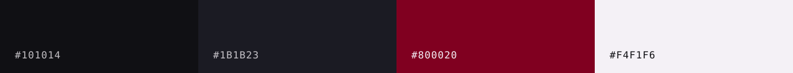

<p align="center">
  
</p>

Sitio corporativo de **Aetherys**, equipo de desarrollo de software a medida: desde landing pages hasta plataformas SaaS, integración de IA y modernización de sistemas.

## Stack

Vite · React 19 · TypeScript · Tailwind CSS 4 · Framer Motion · Lenis · Three.js / React Three Fiber

## Desarrollo

```sh
pnpm install
pnpm dev       # servidor local
pnpm build     # typecheck + build de producción
pnpm lint
pnpm preview   # sirve el build generado
```

## Estructura

```text
src/
  pages/        páginas: inicio, proyectos, detalle de proyecto, contacto
  sections/     secciones de la portada
  features/     escenas 3D (hero, siguiente paso)
  components/   layout (navbar, menú, idioma) y UI compartida
  content/      textos ES/EN y datos de proyectos
  hooks/        preferencias de movimiento
docs/plans/     especificaciones de diseño y animación
```

## Identidad



| Token                | Valor     | Uso                    |
| -------------------- | --------- | ---------------------- |
| `--color-graphite`   | `#101014` | Fondo principal        |
| `--color-dark-gray`  | `#1B1B23` | Superficies y tarjetas |
| `--color-burgundy`   | `#800020` | Acentos y botones      |
| `--color-warm-white` | `#F4F1F6` | Texto, logo e iconos   |

Las reglas completas de marca, diseño y trabajo viven en [`AGENTS.md`](AGENTS.md).

---

<p align="center"><sub>© Aetherys</sub></p>
